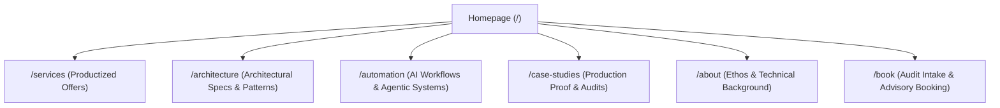

# Master Portfolio & Consulting Website Blueprint: isaacgitonga.com

> **Positioning**: Principal Architect, Product Director & Technical Consultant  
> **Target Audience**: Founders, CTOs, Engineering Leads, Enterprise Technical Buyers  
> **Primary Goal**: Position as a high-authority systems consultant, capture architectural audit leads, and showcase production-grade technical specs.

---

## 🏛️ 1. Information Architecture & Sitemap

---

## 🎨 2. Visual Aesthetic & UX Standards

*   **Design Paradigm**: Modern Dark Mode / Precision Engineering Aesthetic (Glassmorphism, subtle grid lines, terminal accents, smooth micro-animations using GSAP).
*   **Typography**: Inter / Outfit for headlines, Fira Code / JetBrains Mono for architecture specs and code snippets.
*   **Color Palette**: Deep Charcoal (`#0B0F17`), Electric Cyan/Blue (`#38BDF8`), Muted Silver (`#94A3B8`), and Emerald Accent (`#34D399` for system health/integrity).
*   **Tone**: Blunt, authoritative, analytical, outcome-driven. Zero generic buzzwords ("passionate developer", "rockstar").

---

## 📄 3. Detailed Page Breakdown & Wireframes

### Page 1: Homepage (`/`) — The High-Authority Portal

#### 1. Hero Section
*   **Headline**: *"I Architect Backend Infrastructure That Survives Production."*
*   **Subheadline**: *"Helping growing tech companies untangle technical debt, guarantee payment ledger integrity, isolate multi-tenant data, and build deterministic AI agent workflows."*
*   **Primary CTA**: `[ Book an Architectural Audit ]` (Links to `/book`)
*   **Secondary CTA**: `[ Explore Architecture Specs ]` (Links to `/architecture`)
*   **Visual Element**: Interactive animated node graph (GSAP) showing a resilient backend system handling a high-concurrency traffic spike gracefully.

#### 2. Authority & Specialization Banner
*   4 Core Pillars with live status indicators:
    1. 🛡️ **Idempotent Payment Ledgers** (Zero state inconsistencies)
    2. 🔒 **Multi-Tenant Context Isolation** (RBAC / Row-Level Security)
    3. ⚡ **Concurrency-Safe Backends** (Pessimistic locking & outbox patterns)
    4. 🤖 **Deterministic RAG & Agent Systems** (Strictly bounded AI pipelines)

#### 3. The Core Thesis ("Why Software Fails")
*   A blunt 3-column breakdown of why production platforms break:
    *   *The Trap*: Rushed MVP code, unmanaged technical debt, and framework lock-in.
    *   *The Cost*: Silent data corruption, payment webhook drops, and security leaks.
    *   *The Fix*: Isolated domain architecture, database-level integrity, and strict boundary conditions.

#### 4. Productized Services Showcase (6 Offers Matrix)
*   Card grid linking directly to detailed sections on `/services`:
    1. Resilient Backend & API Infrastructure
    2. Enterprise Identity & Access Control (RBAC/ABAC)
    3. Idempotent Payment & Billing Architectures
    4. Data-Dense Admin Consoles & Real-Time Sync
    5. Architectural Risk Auditing & Consultation
    6. Deterministic RAG & Secure Agent Integration

#### 5. Featured Architecture Specification Blueprint
*   Embed a live code/spec viewer featuring an architectural pattern (e.g., *Concurrency-Safe Inventory Ledger* or *Asynchronous Webhook Outbox*).
*   Demonstrates deep technical authority before a client even contacts you.

#### 6. Contact & Engagement Banner
*   **Headline**: *"Facing a fragile system or preparing for high traffic?"*
*   **CTA**: `[ Schedule a System Audit ]`

---

### Page 2: Services & Solutions (`/services`) — Productized Advisory

Instead of vague hourly consulting, this page lays out fixed-scope, high-impact offerings:

1. **Service Card Structure**:
   * **The Problem**: What acute friction the client is facing.
   * **The Approach**: How you solve it architecturally.
   * **The Deliverable**: Concrete outcomes (e.g., "A blunt 20-page audit report + step-by-step remediation plan").
   * **Pricing Anchor**: Fixed-rate package range or advisory engagement model.

2. **The 6 Offer Offerings**:
   * Detailed copy pulled directly from [`portfolio.md`](file:///home/isaac/DevStudio/core/atlas/portfolio.md#L44-L77).

---

### Page 3: Architecture Catalog (`/architecture`) — The Proof of Authority

This acts as an **Evergreen Engineering Library** that sets you apart from 99% of developers:

*   **Format**: Clean, structured architectural RFCs / Specs.
*   **Spec Structure**:
    *   `1. System Context & Challenge`
    *   `2. Topology Diagram` (Mermaid / GSAP SVG)
    *   `3. Data Flow & Transaction Boundaries`
    *   `4. Concurrency & Failure Modes`
    *   `5. Trade-off Analysis`
*   **Featured Specs**:
    *   *Asynchronous Payment Checkout Outbox Engine*
    *   *Concurrency-Safe Inventory Ledger (`SELECT ... FOR UPDATE`)*
    *   *Database-Level Row-Level Security (RLS) Multi-Tenancy*

---

### Page 4: AI & Agent Automation (`/automation`) — Off-Screen Leverage

*   Showcases how you leverage custom AI agents and deterministic pipelines to deliver work 2x–3x faster.
*   **Showcase**: *Automated Architectural Comparison Engine* (Self-Auditing Protocol from `agent.md`).
*   **Value Proposition**: *"I use agentic automation to eliminate boilerplate and spend 80% of client hours on high-level architecture and system correctness."*

---

### Page 5: Engagement & Audit Booking (`/book`) — High-Conversion Intake

*   **Step 1: Self-Selection Quiz / Qualification Filter**:
    *   What type of system do you run? (Monolith, Microservices, SaaS, Payment Gateway)
    *   What is your immediate bottleneck? (Traffic spikes, security audit, payment bugs, AI reliability)
*   **Step 2: Intake Form**:
    *   Company Name & Tech Stack
    *   Current Monthly Active Users / Transaction Volume
    *   Target Timeline
*   **Step 3: Direct Scheduling Link**: (Calendly/Cal.com embed for 30-minute discovery call).

---

### 📧 Email Exposure & Touchpoint Policy

* **Publicly Exposed Address**: **`advisory@isaacgitonga.com`**
  * **Placement**: Global footer, `/services` page contact section, and `[ Copy Email ]` buttons.
  * **Purpose**: Positioned specifically for audit requests, technical consultations, and RFP inquiries.
* **Secondary Public Address**: **`hello@isaacgitonga.com`** (Optional catch-all for general inquiries/press).
* **Form API Backend Integration**: 
  * The intake form on `/book` (`POST /api/book`) uses **Resend API** behind the scenes to deliver structured audit requests directly to `advisory@isaacgitonga.com`.
* **STRICTLY PRIVATE (Do NOT Expose in UI/Code)**:
  * ❌ `billing@isaacgitonga.com` (Reserved exclusively for client invoices, contracts, and financial receipts).
  * 🔒 `isaac@isaacgitonga.com` (Reserved for direct, high-value client threads and warm introductions).

---

## 🎯 4. Key Strategic Checklist Before Building

- [ ] Ensure no generic buzzwords are used across copy.
- [ ] Implement dark-mode precision styling with monospace code accents.
- [ ] Link every service offer directly to an architectural spec proof on `/architecture`.
- [ ] Add clickable links to live case studies or sandbox prototypes.
- [ ] Implement UI email copy component (`advisory@isaacgitonga.com`) with spam obfuscation.