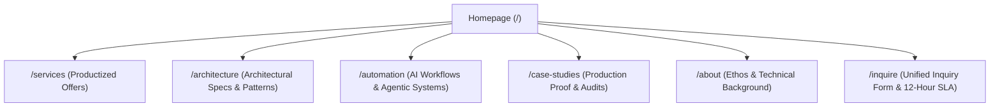

# Portfolio Visual Theme & Wireframe Specs (`docs/wireframes.md`)

> **Directory Purpose**: Detailed page breakdowns, information architecture, visual theme, and interaction specifications for `isaacgitonga.com`.

---

## 🏛️ 1. Information Architecture & Sitemap

---

## 🎨 2. Visual Aesthetic & UX Standards

*   **Design Paradigm**: Modern Dark Mode / Precision Engineering Aesthetic (Glassmorphism, subtle grid lines, terminal accents, smooth micro-animations using GSAP).
*   **Typography**: Inter / Outfit for headlines, Fira Code / JetBrains Mono for architecture specs and code snippets.
*   **Color Palette**: Deep Charcoal (`#0B0F17`), Electric Cyan (`#38BDF8`), Muted Silver (`#94A3B8`), and Emerald Accent (`#34D399` for system health).
*   **Tone**: Blunt, authoritative, analytical, outcome-driven.

---

## 📄 3. Detailed Page Breakdown & Interactions

### Page 1: Homepage (`/`) — High-Authority Portal
*   **Hero Section**:
    *   *Left Column (Copy & CTA)*: Headline (*"Engineering the software your business cannot afford to get wrong."*), Subheadline (*"Helping startups and growing platforms build software designed to survive scale. Fixed-scope architectural outcomes that protect data correctness and eliminate 2 AM outages."*), **single** Primary CTA (`[ Submit System Inquiry ]` -> `/inquire`), and 12-Hour SLA response badge.
        *   **`[ Explore Services ]` removed from the hero (2026-08-07).** Two competing CTAs split intent and let a visitor browse instead of enquiring. Browsing is now a qualified fallback in the Pillars section below.
    *   *Right Column (Visual Hero Element)*: **Interactive Telemetry & Command Console** — Glassmorphic dark terminal with live status indicator (`SYSTEM_STATUS: NOMINAL`), interactive command tabs (`$ inspect --layer=payments`, `--layer=concurrency`, `--layer=security`), live code/telemetry viewer, and contextual CTA bridge to `/inquire`.
*   **Core Engineering Pillars** *(section heading: `CORE ENGINEERING PILLARS`)* — in this order:
    1.  Four cards: **Idempotent Payment Ledgers · Multi-Tenant Context Isolation · Concurrency-Safe Backends · Deterministic RAG Systems**
    2.  Transition line **below the cards**: *"Only need one of these — not a full build?"*
    3.  Secondary CTA: `[ Explore Services ]` -> `/services`
    *   **Order is deliberate.** The transition line must come *after* the cards. Leading with it tells the majority — who do want a build — that the section is not for them, and they skip the strongest credibility block on the page. Pillars read as proof first; the doorway sits directly beneath, where a component-buyer will already be looking.
    *   **Link each card to its architecture spec** (`/architecture/[slug]`): payments → `asynchronous-payment-checkout`, concurrency → `concurrency-safe-inventory-ledger`, isolation → `database-level-row-level-security`. This turns the pillars from claims into one-click evidence.
    *   ⚠ **Deterministic RAG has no backing spec yet.** It should not carry the most visual weight of the four until one exists.
*   **Core Thesis & Bottleneck Banner**: *"I don’t over-engineer your application. I isolate fragile bottlenecks so your core platform can scale without unexpected 2 AM outages."*
*   **Featured Offers Grid**: Links to `/services`. *(Catalogue is nine offers in four categories — lead with the categories, not nine flat cards. See `atlas/services/README.md`.)*
*   **Featured Architecture Spec Blueprint**: Embeds live code/spec viewer.

### Page 2: Services Showcase (`/services`)
*   **Header Intro**: *"I build, test, and verify the most critical components of your software."*
*   Grid of productized advisory offerings. Each card includes problem statement, architectural approach, concrete deliverables, tech stack, pricing anchor, and a contextual CTA (`[ Inquire for This Offer ]` -> `/inquire?service=slug`).

### Page 3: Architecture Catalog (`/architecture`)
*   Evergreen Engineering Library featuring structured RFCs (Context, Topology Diagram, Data Flow, Failure Modes, Trade-off Arbitrage).

### Page 4: AI & Agent Automation (`/automation`)
*   Showcase of custom local agent workflows and deterministic build pipelines.

### Page 5: Unified Inquiry & Client Intake (`/inquire`) — 12-Hour SLA Funnel
*   **Design Goal**: Zero third-party script bloat, zero calendar booking friction. A single, high-conversion intake form with a guaranteed 12-hour response SLA.
*   **Service Level Guarantee (SLG)**: Banner stating **"Guaranteed personal response within 12 hours of submission."**
*   **Dynamic State Rules**:
    *   **Rule A (Direct visit `/inquire`)**: Displays the general **`Inquiry Category`** dropdown (`INQUIRY_CATEGORY_MAP`).
    *   **Rule B (Contextual visit `/inquire?service=slug`)**: Hides the generic category dropdown and displays a highlighted context badge: *"Inquiring for: Service Title"*, locking the service slug into submission.
*   **Form Fields**: `Full Name` (Req), `Organization / Company` (Req), `Work Email` (Req), `Message` (Opt), `Inquiry Category / Service` (Dynamic per Rule A / B).
*   **Automated Auto-Responder**: Resend API delivers instant confirmation email re-stating the 12-hour response SLA.

---

## 📧 Email Exposure & Touchpoint Policy

*   **Publicly Exposed Address**: **`advisory@isaacgitonga.com`** (Footer, `/inquire` fallback button `[ Copy Email ]`).
*   **Secondary Address**: **`hello@isaacgitonga.com`** (Catch-all for general/press).
*   **Backend Integration**: Intake form posts to `POST /api/inquire` via Resend API directly to `advisory@isaacgitonga.com`.
*   **STRICTLY PRIVATE**: `billing@isaacgitonga.com` and `isaac@isaacgitonga.com`.
