Most costly payment integration failures stem from treating webhooks and checkout APIs as simple, synchronous RPC actions. When network drops, API timeouts, or client-side cancellations occur, systems bleed state, resulting in double-charging or orphaned transactions. 

Here is the architectural specification for an asynchronous, outbox-driven mobile money (e.g., M-Pesa / Stripe STK push) payment checkout flow built for transactional integrity.

---

## 1. System Context & Challenge

In standard mobile money integrations (such as Safaricom's Daraja STK Push), the payment intent creation and payment confirmation are tightly coupled on the telecom side. You invoke their API, they return a `CheckoutRequestID`, and they immediately dispatch a PIN prompt to the user's phone.

### The Vulnerability
If your database transaction fails or times out *after* the API call but *before* you persist the `CheckoutRequestID` in your database:
- The user still receives the PIN prompt and pays.
- The telecom calls your callback URL with the status.
- Your server receives a webhook for an unknown `CheckoutRequestID` (an orphaned callback).
- The order is never marked as paid, the inventory remains locked or gets released, and the customer is charged without receiving their goods.

---

## 2. Topology Diagram

```mermaid
sequenceDiagram
    autonumber
    actor User as Client/Browser
    participant API as API Gateway / Web Server
    participant DB as PostgreSQL Database
    participant Queue as Redis Queue (BullMQ)
    participant Provider as Payment Gateway (M-Pesa / Stripe)
    participant Worker as Background Outbox Worker

    User->>API: 1. Initiate Checkout
    activate API
    note over API, DB: Database Transaction Boundary (Unit of Work)
    DB->>DB: 2. Acquire Temporary Inventory Lock (TTL)
    DB->>DB: 3. Create Pending Order & Payment Intent
    DB->>DB: 4. Write Asynchronous Job to Outbox Table
    API->>DB: Commit Transaction
    deactivate API

    rect rgb(20, 30, 45)
        note right of Worker: Outbox Processing Loop
        Worker->>DB: 5. Claim Pending Outbox Job
        Worker->>Provider: 6. Fire STK Push / Intent API
        Provider-->>Worker: 7. Return CheckoutRequestID
        Worker->>DB: 8. Update Payment Record with CheckoutRequestID
    end

    User->>User: 9. Receives PIN Prompt & Authorizes Payment
    Provider->>API: 10. Async Callback Callback URL (Webhook)
    activate API
    API->>Queue: 11. Enqueue Webhook Event Job (Deduplicated)
    API-->>Provider: 200 OK (Acknowledge)
    deactivate API

    Queue->>Worker: 12. Consume Webhook Event
    Worker->>DB: 13. Reconcile Ledger, Unlock Inventory & Finalize Order
```

---

## 3. Data Flow & Transaction Boundaries

To prevent locking database resources during external network calls, we decouple the database transaction from the payment gateway's API call using the **Transactional Outbox Pattern**.

### Step 1: Intent Initialization (Strictly Database Bound)
Within a single database transaction (Unit of Work):
1. **Inventory Reservation**: Insert a row in an `inventory_reservations` table with a short Time-To-Live (e.g., 5 minutes) to protect ticket/stock availability.
2. **Order Lifecycle**: Create an `orders` record in state `PENDING_PAYMENT`.
3. **Outbox Log**: Write a new event payload to the `outbox_jobs` table containing the user metadata and payment details.
4. **Immediate Response**: Commit the transaction and return a `202 Accepted` to the client. This releases the database connection back to the pool immediately.

### Step 2: Outbox Worker Dispatch
A highly optimized background worker continuously pulls jobs from the `outbox_jobs` table, makes the HTTP call to the telecom gateway, and maps the returned provider identifier (e.g., `CheckoutRequestID`) back to our `payment_intents` table.

---

## 4. Concurrency & Failure Modes

Production environments are unreliable. The system is engineered to survive the following failure scenarios:

### Case A: Callback Delivery Failure (Dropped Webhook)
*   **The Risk**: The network drops the telecom's callback payload.
*   **The Mitigation**: A cron worker runs every 60 seconds, querying the database for payments in `PENDING` state older than 3 minutes. It queries the payment gateway's query endpoint directly using the Transaction Status API.

### Case B: Callback Redelivery & Webhook Race Conditions
*   **The Risk**: The payment gateway retries callbacks, or database locks cause updates to overlap.
*   **The Mitigation**: 
    1. The webhook endpoint acts as a simple ingester, saving raw events to an `idempotency_keys` audit log.
    2. Before processing, the worker checks if `MpesaReceiptNumber` or the transaction key has already been reconciled.
    3. We use PostgreSQL's `SELECT ... FOR UPDATE` on the payment record during webhook execution to serialize state updates.

### Case C: Compensating Transactions (Expired Reservation)
*   **The Risk**: The user is slow to enter their PIN, exceeding the 5-minute inventory reservation window.
*   **The Mitigation**: If a webhook confirms a payment *after* the reservation expires, the background worker transitions the order to `RECONCILIATION_REQUIRED`. This alerts operators to manually resolve the order or trigger an automated refund transaction.

---

## 5. Trade-off Analysis

| Architecture Decision                 | Advantages                                                                                                | Trade-offs                                                                                                  |
|:--------------------------------------|:----------------------------------------------------------------------------------------------------------|:------------------------------------------------------------------------------------------------------------|
| **Transactional Outbox Pattern**      | • Releases DB connection pool immediately. • Prevents database lock exhaustion during network latency. | • Increases infrastructure complexity. • Requires background worker monitoring (e.g., PM2 / Kubernetes). |
| **Short-TTL Inventory Reservation**   | • Prevents stock hoarding by idle checkout pages. • Automatically cleans up unpaid inventory.          | • Requires handling edge cases where payment completes post-expiration.                                     |
| **Strict Database-Level Idempotency** | • Guarantees that a customer is never credited twice for duplicate callbacks.                             | • Requires indexing and auditing every incoming webhook transaction hash.                                   |
