In transaction systems like ticketing, e-commerce, or ride-hailing, handling concurrent resource allocation correctly is the difference between a functional product and a PR disaster. When thousands of users request the exact same item within milliseconds, standard naive queries read stale counts, leading to over-selling and data corruption.

Here is the architectural specification for a concurrency-safe inventory ledger utilizing PostgreSQL pessimistic locking.

---

## 1. System Context & Challenge

Consider a flash sale where 10 items are left, and 100 concurrent requests arrive.
A naive implementation does this:
1. `SELECT stock FROM items WHERE id = ?` (Returns 10)
2. If `stock > 0`, proceed to create booking.
3. `UPDATE items SET stock = stock - 1 WHERE id = ?`

### The Vulnerability
Under concurrency, multiple threads execute Step 1 before any thread commits Step 3. All threads read a stock level of 10. They all proceed to write bookings and decrement the stock. The stock level drops below zero, and you end up with 100 tickets sold for 10 physical seats.

Using optimistic locks (e.g. `version` columns) prevents data corruption but results in massive transaction abort rates ("first committer wins"), giving a terrible user experience where 90% of users get errors even though inventory is technically still available.

---

## 2. Topology Diagram

```mermaid
sequenceDiagram
    autonumber
    actor User1 as Customer A (Request)
    actor User2 as Customer B (Request)
    participant Server as App Instance
    participant DB as PostgreSQL Database

    User1->>Server: 1. Attempt Reservation
    User2->>Server: 2. Attempt Reservation
    activate Server
    
    rect rgb(20, 25, 35)
        note over Server, DB: Transaction A Starts
        Server->>DB: 3. SELECT stock FROM items WHERE id = X FOR UPDATE
        activate DB
        note over DB: Locks Row X
        DB-->>Server: 4. Returns stock = 1
    end

    rect rgb(25, 20, 25)
        note over Server, DB: Transaction B Starts
        Server->>DB: 5. SELECT stock FROM items WHERE id = X FOR UPDATE
        note over DB: Lock Contention! Transaction B Waits...
    end

    Server->>DB: 6. INSERT INTO reservations (item_id, user_id)
    Server->>DB: 7. UPDATE items SET stock = stock - 1 WHERE id = X
    Server->>DB: 8. COMMIT Transaction A
    deactivate DB
    note over DB: Releases Row X Lock

    activate DB
    note over DB: Transaction B resumes, locks Row X
    DB-->>Server: 9. Returns stock = 0
    note over Server: Logic: stock is 0! Rollback Transaction B.
    Server-->>User2: 10. Out of Stock (Graceful Fail)
    deactivate DB
    Server-->>User1: 11. Booking Confirmed
    deactivate Server
```



---

## 3. Data Flow & Transaction Boundaries

To guarantee correctness, all inventory operations must run under explicit PostgreSQL transaction blocks paired with row-level locks.

### Code Pattern (SQL Blueprint)
```sql
-- 1. Start the transaction block
BEGIN;

-- 2. Lock the specific inventory item row.
-- This blocks any other concurrent transactions attempting to read/write this row.
SELECT stock, reserved_stock 
FROM inventory_items 
WHERE sku = 'TICKET-CONCERT-2026' 
FOR UPDATE;

-- 3. Run validation logic in application memory:
-- IF stock - reserved_stock >= requested_quantity THEN:

-- 4. Record the individual ledger entry (for auditable history)
INSERT INTO inventory_ledger_entries (sku, quantity, type, reservation_id)
VALUES ('TICKET-CONCERT-2026', -1, 'RESERVATION', 'res_8923a');

-- 5. Update the aggregate stock level
UPDATE inventory_items 
SET reserved_stock = reserved_stock + 1 
WHERE sku = 'TICKET-CONCERT-2026';

-- 6. Commit the transaction, releasing the lock.
COMMIT;
```

---

## 4. Concurrency & Failure Modes

### Case A: Deadlocks
*   **The Risk**: Transaction A locks Item X and tries to lock Item Y; Transaction B locks Item Y and tries to lock Item X. The database hangs in a deadlock.
*   **The Mitigation**: 
    1. We enforce sorting order on locked resources: always lock SKUs in alphabetical/numerical order when updating multiple items in a single transaction.
    2. We set a low `statement_timeout` (e.g. `SET local statement_timeout = 3000;`) to prevent requests from hanging indefinitely.

### Case B: Connection Pool Exhaustion (Row Starvation)
*   **The Risk**: High concurrency locks rows, queueing transactions and holding database connections open, rapidly depleting the server's connection pool.
*   **The Mitigation**:
    *   We use PostgreSQL's `FOR UPDATE NOWAIT` or `FOR UPDATE SKIP LOCKED` for systems where users can check out other alternative seats/items if one is locked. 
    *   `SKIP LOCKED` allows transactions to bypass already-locked inventory rows, maintaining high throughput for large-catalog flash sales.

---

## 5. Trade-off Analysis

| Pattern                                      | Advantages                                                                                     | Trade-offs                                                                                                                                   |
|:---------------------------------------------|:-----------------------------------------------------------------------------------------------|:---------------------------------------------------------------------------------------------------------------------------------------------|
| **Pessimistic Locking (`FOR UPDATE`)**       | • Absolute consistency guarantee.<br>• Zero overselling risk.<br>• Database-enforced ordering. | • Holds database connection open during processing.<br>• Can bottleneck throughput if locking a single hot row (e.g. a single concert seat). |
| **Optimistic Locking (`WHERE version = x`)** | • Non-blocking read operations.<br>• Ideal for low-concurrency resource editing.               | • Terrible user experience under high contention (many aborted/retried transactions).                                                        |
| **Redis-First Counter with DB Outbox**       | • Sub-millisecond locking speeds.<br>• Offloads read traffic from primary SQL DB.              | • Requires synchronization logic.<br>• Risk of state desync if Redis node crashes without persistence.                                       |
