For multi-tenant Software-as-a-Service (SaaS) platforms, data isolation is the absolute baseline of security compliance. The most common security vulnerability in SaaS is "broken object-level authorization" (OWASP API1), where an authenticated user can read or edit another tenant’s data by modifying an ID parameter.

Here is the architectural specification for a bulletproof data isolation model enforced directly within PostgreSQL using Row-Level Security (RLS).

---

## 1. System Context & Challenge

In standard SaaS models, every table contains a `tenant_id` foreign key. The application code is responsible for appending a `WHERE tenant_id = current_tenant` clause to every single database query.

### The Vulnerability
Relying on application code to enforce data isolation is fragile. As a codebase grows and developers join:
- A developer writes a query and forgets to append the `tenant_id` check.
- A background worker queries records globally but exposes them via a tenant-scoped endpoint.
- An ORM relation loader loads child entities without linking them back to the tenant owner.

A single missed check results in a silent, high-impact data leak.

---

## 2. Topology Diagram

```mermaid
sequenceDiagram
    autonumber
    actor User as Client (Tenant B)
    participant API as API Server / ORM
    participant DB as PostgreSQL (RLS Active)

    User->>API: 1. Request /api/projects
    activate API
    note over API: Extracts tenant_id = 'tenant-b-99' from JWT
    
    rect rgb(20, 25, 35)
        note over API, DB: Database Connection Boundary
        API->>DB: 2. SET LOCAL app.current_tenant = 'tenant-b-99'
        API->>DB: 3. SELECT * FROM projects (No WHERE clause!)
        activate DB
        note over DB: Database Engine Evaluates RLS Policy:<br>WHERE tenant_id = current_setting('app.current_tenant')
        DB-->>API: 4. Returns only Tenant B records
        deactivate DB
    end

    API-->>User: 5. Rendered Project List
    deactivate API
```



---

## 3. Data Flow & Transaction Boundaries

Enforcing RLS requires database-level policies combined with setting a local session variable for every connection checked out from the pool.

### Step 1: Schema Setup & Policy Definition
We configure PostgreSQL to block all queries on target tables unless they comply with the RLS policy.

```sql
-- 1. Enable RLS on the multi-tenant table
ALTER TABLE projects ENABLE ROW LEVEL SECURITY;

-- 2. Define the security policy
-- This policy intercepts SELECT, INSERT, UPDATE, and DELETE queries.
CREATE POLICY tenant_isolation_policy ON projects
    FOR ALL
    USING (tenant_id = NULLIF(current_setting('app.current_tenant', true), ''))
    WITH CHECK (tenant_id = NULLIF(current_setting('app.current_tenant', true), ''));
```

### Step 2: Connection Middleware Lifecycle
When the application server handles an incoming request, it extracts the authenticated user's `tenant_id` from their session token (JWT/Cookie). Before running any business logic query, it wraps the connection checkout process:

```typescript
// Node.js/TypeScript PostgreSQL Transaction Wrapper
async function runWithTenantContext<T>(tenantId: string, operation: (client: Client) => Promise<T>): Promise<T> {
  const client = await dbPool.connect();
  try {
    await client.query('BEGIN');
    
    // Set the session-level variable. 
    // LOCAL ensures it only persists for the duration of this transaction.
    await client.query('SELECT set_config($1, $2, true)', ['app.current_tenant', tenantId]);
    
    // Execute business queries inside the context
    const result = await operation(client);
    
    await client.query('COMMIT');
    return result;
  } catch (error) {
    await client.query('ROLLBACK');
    throw error;
  } finally {
    client.release();
  }
}
```

---

## 4. Concurrency & Failure Modes

### Case A: Connection Pooling Leakage
*   **The Risk**: Connection pools reuse TCP sockets. If the application server fails to reset the `app.current_tenant` variable or queries run outside a transaction, a subsequent request might execute with the previous request’s tenant context.
*   **The Mitigation**: 
    1. We enforce `LOCAL` scope on session variables (`SET LOCAL app.current_tenant`), ensuring they automatically clear when the transaction block completes.
    2. The application database user runs under restricted permissions, unable to disable RLS.

### Case B: Background Jobs & Superuser Access
*   **The Risk**: System cron jobs, analytical reporting, and billing workers need to read data globally across all tenants. If RLS is enabled globally, these queries return empty sets.
*   **The Mitigation**:
    *   We create a separate database role (`analytics_worker`) which is granted the `BYPASSRLS` permission.
    *   The background worker connects using this role, allowing global aggregation while keeping the main web-facing server role sandboxed.

---

## 5. Trade-off Analysis

| Isolation Level                 | Advantages                                                                                                                    | Trade-offs                                                                                                                                           |
|:--------------------------------|:------------------------------------------------------------------------------------------------------------------------------|:-----------------------------------------------------------------------------------------------------------------------------------------------------|
| **Row-Level Security (RLS)**    | • Database-enforced isolation.<br>• Protects against developer error / missed where-clauses.<br>• Centralized security logic. | • Slight performance overhead on query planning.<br>• Harder to debug local database dumps.<br>• Requires strict connection pool session management. |
| **Application-Level Isolation** | • Dynamic query building.<br>• Fully independent of the DB engine.                                                            | • Extremely high risk of developer-induced leaks.<br>• Audits require reviewing the entire application codebase.                                     |
| **Database-Per-Tenant**         | • Zero risk of logical leaks.<br>• Simple tenant backup & restoration.                                                        | • Massive infrastructure overhead.<br>• High cost of running schema migrations across hundreds of databases.                                         |
